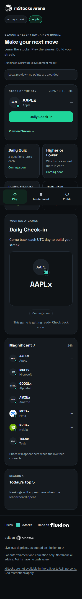
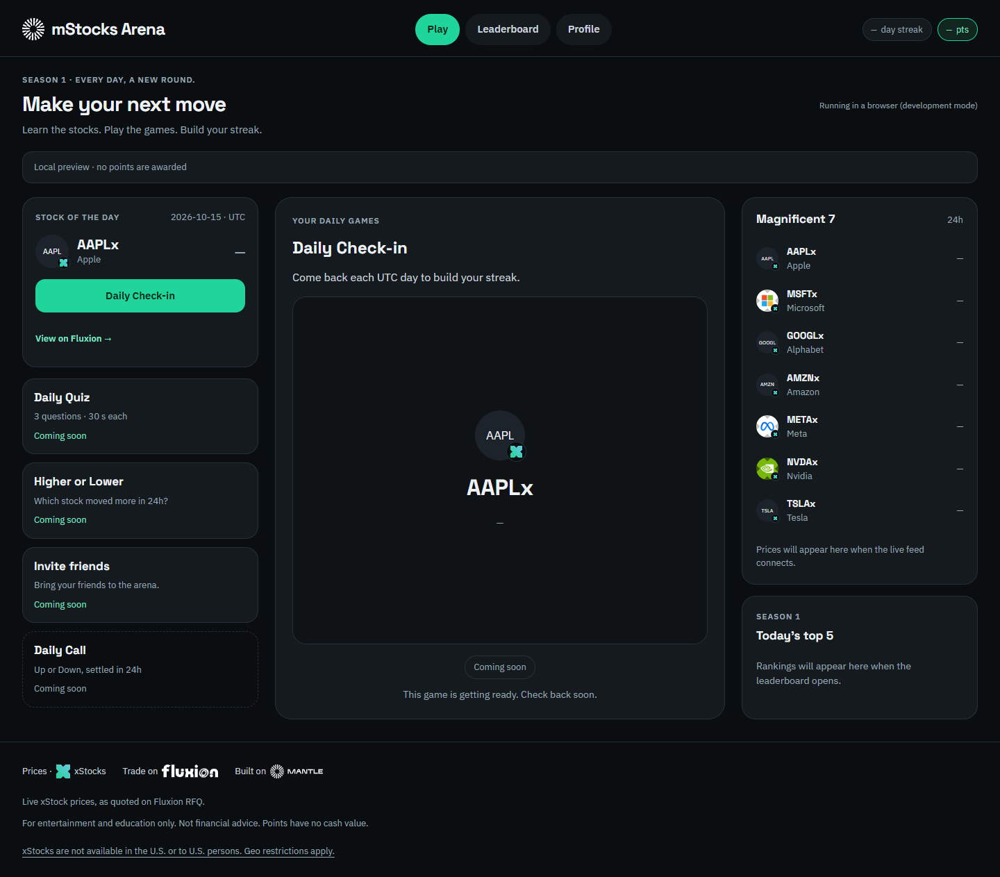

# T08 — verificação do shell

Verificado em 15/10/2026 no Windows, Node 24.19.0, pnpm 10.28.0 e Microsoft Edge
headless via Playwright. Capturas abaixo são da prévia local; não representam
logins reais no Discord ou Telegram.

## Resultado

- Lint, format:check, typecheck, 138 testes unitários e build passaram.
- 7 testes Playwright passaram: quatro larguras (360, 768, 1024 e 1440 px),
  bloqueio da prévia em produção, login/links do Telegram simulados e retry após
  erro da API. Sem rolagem horizontal ou exceções de JavaScript nas quatro larguras.
- Abas Play, Leaderboard e Profile navegáveis; seleção do jogo troca o painel
  central. Desktop com três colunas, tablet com duas e celular com abas fixas no
  rodapé e espaço para safe area.
- SDK do Discord simulado nos testes unitários: ready → authorize → API relativa
  → authenticate. Login deduplicado, inclusive sob React StrictMode.
- Tokens de sessão somente em memória; testes confirmam ausência em localStorage
  e sessionStorage. Nenhum login falso na API.
- Logos usam as URLs da xStocks; se a imagem demorar ou falhar, o círculo mostra
  o ticker. Selo e fallback usam os tokens de cor do design.
- Aviso legal exato aprovado e link para a documentação da xStocks no app e README.
- A paleta da marca permanece inalterada nos temas claro e escuro do Telegram,
  inclusive em `themeChanged`; somente header e background do host recebem nosso
  `--bg`. Verificado nos testes unitários e no navegador. Skip link: "Skip to content".

Novas dependências: `@discord/embedded-app-sdk` 2.5.0 (ponte oficial), Zod 3.25.76
(validação das respostas de login), Fontsource 5.3.0 para as três fontes locais do
design e `@playwright/test` 1.64.1 (testes reproduzíveis no navegador). As versões
das dependências existentes foram preservadas.

## Reproduzir

```powershell
pnpm install --frozen-lockfile
pnpm lint
pnpm format:check
pnpm typecheck
pnpm test
pnpm build
$env:PLAYWRIGHT_CHANNEL = "msedge"
pnpm test:web
```

Sem Edge, instalar Chromium com `pnpm exec playwright install chromium` e executar
sem `PLAYWRIGHT_CHANNEL`. O CI instala Chromium e executa os testes de interface.
Os servidores dos testes usam apenas web nas portas 5173 e 5174; nenhuma conexão
ao Supabase é necessária.

## Capturas

Mobile, 360 px:



Desktop, 1440 px:



## Pendências de aceitação externa

O smoke test e as capturas em servidor Discord e bot Telegram reais aguardam os
apps de teste e staging. Os testes simulados não confirmam a integração real.
Os jogos, preços ao vivo e rankings permanecem em estados de espera até T09–T13;
o protótipo forneceu a referência visual, sem virar implementação de regras.
